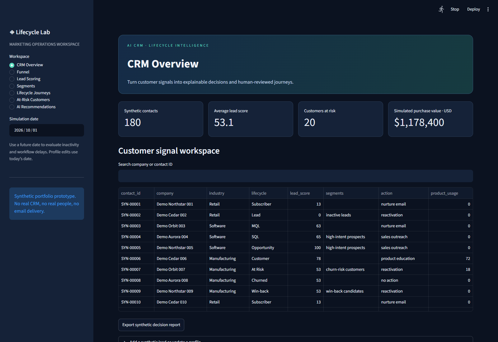
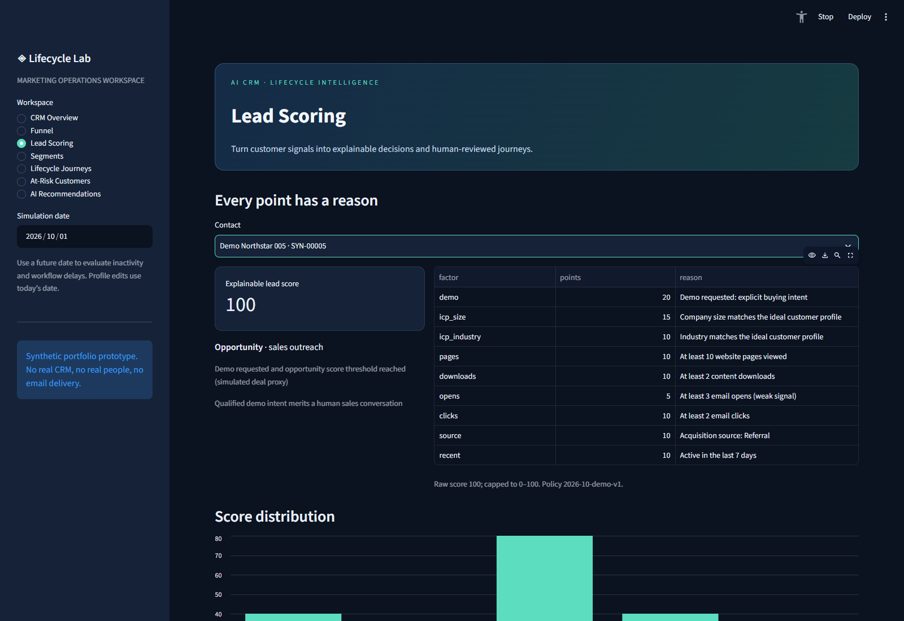
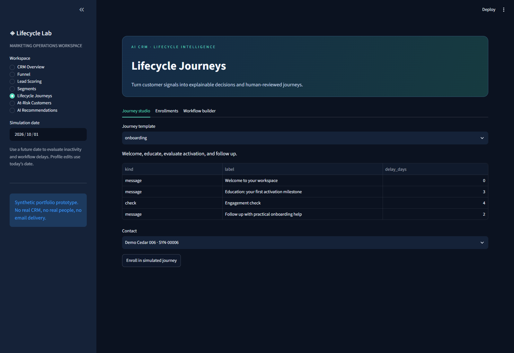
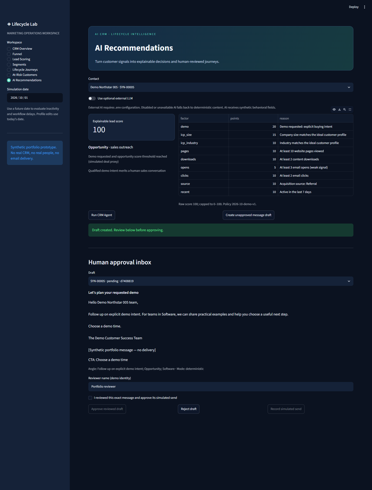
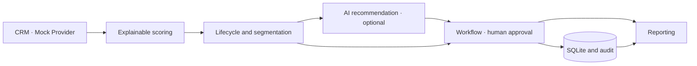

# AI CRM Lifecycle & Lead Scoring Agent

**A marketing operations portfolio prototype: customer signals → explainable decisions → human-reviewed journeys.**

Python · FastAPI · Streamlit · pandas · SQLite · Pydantic · pytest · Docker

> All accounts, behavior, and purchase values are synthetic. This is a portfolio prototype, not a production CRM. No CRM credentials are required. No email is delivered, and the AI agent has no send capability.



## Business problem

Marketing teams often have fragmented engagement signals, static lifecycle labels, opaque qualification scores, and disconnected retention campaigns. Sales receives poorly qualified leads while customer success misses declining adoption. This prototype joins those signals into one inspectable workflow with a clear explanation for every score and action.

The goal is to demonstrate marketing automation design, CRM modeling, AI integration, and operational controls. It does not claim measured conversion uplift or predictive accuracy. Useful production KPIs would include MQL-to-SQL conversion, time to first qualified outreach, activation rate, campaign engagement, and retention; this demo reports fixture distributions and simulated operations only.

## What works

- Seeded synthetic profiles across nine lifecycle stages, with fit, acquisition, engagement, revenue, consent, product usage, and churn signals.
- Configurable policy, rule-based 0–100 scoring, signed explanations, overlapping marketing segments, and next-best actions.
- Optional structured AI interpretation and personalized subject, email, CTA, and message angle, with labeled deterministic fallback.
- Persistent approval inbox with immutable drafts, reviewer identity, stale-profile checks, consent re-checks, rejection, and idempotent simulated sends.
- Onboarding, lead nurture, and win-back templates; visual workflow builder; delays, engagement checks, qualification tasks, and exit on reactivation.
- Seven dashboard views, CSV exports, audit trail, SQLite persistence, typed CRM adapter port, and `MockCRMProvider`.
- Isolated tests, linting, container setup, GitHub Actions, sample JSON, real dashboard screenshots, and a [demo walkthrough](docs/demo-walkthrough.md).

## Quick start

Python **3.11+**. Run commands from the project root. AI remains disabled by default.

```bash
python -m venv .venv
# macOS / Linux
source .venv/bin/activate
# Windows PowerShell: .\.venv\Scripts\Activate.ps1
python -m pip install -r requirements.lock
python -m pip install -e '.[dev]'
```

Copy `.env.example` to `.env` (`cp .env.example .env`, or `Copy-Item .env.example .env` on Windows). Start the API in one terminal:

```bash
python -m uvicorn crm_agent.api:app --host 127.0.0.1 --port 8000
```

Start Streamlit in a second terminal with the same virtual environment:

```bash
python -m streamlit run dashboard/app.py --server.address=127.0.0.1 --server.port=8501
```

Open [dashboard](http://127.0.0.1:8501), [interactive API docs](http://127.0.0.1:8000/docs), or [health](http://127.0.0.1:8000/health). The first API startup generates 180 contacts and installs the three workflow templates. Subsequent restarts preserve data. Change `CRM_DATABASE_PATH` to a new file for a fresh seed; `CRM_SEED_COUNT` and `CRM_SEED` only apply to empty databases.

If a port is busy, choose another API port and set `CRM_API_URL` to match before starting Streamlit.

### Docker

Requires Docker Engine and a recent Compose v2 supporting optional `env_file` entries.

```bash
docker compose up --build
```

The API and dashboard bind to loopback on ports 8000 and 8501. The dashboard waits for a healthy API; SQLite uses a named volume. Containers run as a non-root user. `docker compose down` stops services and preserves data. Choose a new volume or deliberately remove the demo volume if you want to reset it.

Docker is configured and checked by GitHub Actions, but has not been executed on the authoring machine because Docker is unavailable there.

## Dashboard

| View | Marketing question |
|---|---|
| CRM Overview | Which accounts are in the workspace, and what is happening? |
| Funnel | How are lifecycle stages distributed today? |
| Lead Scoring | Why is this prospect qualified, and what signals matter? |
| Segments | Which audience should receive which kind of campaign? |
| Lifecycle Journeys | What is due next, and what is waiting for approval? |
| At-Risk Customers | Which customers show inactivity or adoption problems? |
| AI Recommendations | What should a reviewer do and say next? |





Screenshots are captured from the running app with synthetic fixtures. To refresh them, install the dev dependencies and run `python scripts/capture_dashboard.py --browser-path /path/to/chrome` with both services running. Pass `--url` for a non-default dashboard port. This developer script creates one **pending** synthetic draft and never approves or sends it.

## Architecture



```text
crm_agent/
  models.py       Validated domain contracts
  config.py       .env settings and versioned policy
  synthetic.py    Reproducible scenario generator
  decisions.py    Pure scoring, lifecycle, segmentation, and action functions
  llm.py          Provider protocol, compatible HTTP adapter, and fallback
  service.py      Draft approval and journey orchestration
  repository.py   SQLite transactions, version checks, and audit
  providers.py    CRMProvider port and MockCRMProvider
  workflows.py    Default declarative templates
  api.py          FastAPI adapter and OpenAPI contracts
dashboard/        Streamlit client; mutations go through the API
config/           Editable JSON business policy
data/             Committed synthetic samples; ignored runtime database
tests/            Decision, transaction, API, and dashboard behavior tests
docs/             Architecture, walkthrough, and actual screenshots
```

See [architecture and trust boundaries](docs/architecture.md) for persistence and integration design.

## Lifecycle logic

First matching rule wins. Customer retention states take precedence over prospect acquisition scores.

| Stage | Default rule |
|---|---|
| Win-back | Churned, eligible, consented, and not unsubscribed |
| Churned | Churned and not eligible for a win-back journey |
| At Risk | Customer is inactive, inactive ≥21 days, usage decline ≥40%, or ≥4 support tickets |
| Customer | Active customer without those risk signals |
| Opportunity | Prospect with demo request and score ≥80 |
| SQL | Prospect with demo request and score ≥65 |
| MQL | Prospect with score ≥45 |
| Lead | Prospect with web/download/click/demo activity below MQL threshold |
| Subscriber | Prospect with only subscription-level engagement |

Opportunity is a **simulated deal-intent proxy**, not a real open sales opportunity. SQL is similarly a prototype qualification rule, not an assertion that sales accepted a lead.

Edit `config/rules.json` and restart the API to change qualification thresholds, inactivity windows, ideal-customer fit, segment thresholds, score weights, and acquisition-source points. Update `version` whenever policy changes. Validation rejects inverted thresholds and invalid point ranges. Rule precedence and support/decline cutoffs are explicit in `decisions.py`; changing them requires a reviewed code change and corresponding tests. Existing contact scores are recalculated at request time.

## Explainable lead scoring

| Signal | Default contribution |
|---|---:|
| Demo requested | +20 |
| ICP company size, 50–1000 employees | +15 |
| ICP industry | +10 |
| ≥10 website pages | +10 |
| ≥2 downloads | +10 |
| ≥3 email opens | +5 |
| ≥2 email clicks | +10 |
| Acquisition source | +3 to +10 |
| Activity within 7 days | +10 |
| No activity for 14–29 days | −5 |
| No activity for ≥30 days | −15 |

Contributions sum to `raw_value`, which is capped to 0–100. Recency buckets are mutually exclusive. Opens are deliberately a weak signal. The `SYN-00004` SQL fixture scores **65**: demo +20, company size +15, industry +10, web engagement +10, and referral +10. The actual API explanation reflects the individual fixture, including recency and caps.

There is no trained propensity model or fabricated probability. scikit-learn is intentionally omitted because there are no real outcome labels; training on lifecycle labels generated by the same rules would introduce label leakage and misleading accuracy. A future learned model should be trained on independently observed outcomes, evaluated on time-based holdouts, checked for calibration and bias, and compared with the transparent baseline.

## Segments and next-best actions

Segments overlap: demo intent produces high-intent prospects; ≥30 days without activity creates inactive leads; recent healthy customers create new customers; healthy usage ≥75 creates expansion candidates; At Risk and Win-back create their corresponding retention segments.

Actions follow a documented priority: suppression or ineligible churn → no action; SQL/Opportunity → sales outreach; retention risk/inactive lead → reactivation; new customer → product education; healthy high usage → upsell; other customer → product education; other prospect → nurture email. Onboarding takes precedence over upsell when a customer belongs to both segments.

## AI versus deterministic decisions

| Deterministic authority | Optional AI assistance |
|---|---|
| Score, stage, segment, action, consent gates | Profile summary and opportunity/risk interpretation |
| Workflow entry, delay, progress, and exit | Explanation in natural language |
| Approval state and simulated-send record | Subject, email, CTA, and message angle |

The default agent uses useful templates with **no API key**. Enable external AI only when desired:

```dotenv
CRM_AI_ENABLED=true
CRM_LLM_BASE_URL=https://your-compatible-provider.example/v1
CRM_LLM_API_KEY=your-local-secret
CRM_LLM_MODEL=your-provider-model
```

Restart the API, then enable the external LLM toggle. The adapter posts to `/chat/completions` and expects JSON-object support. `LLMProvider` makes the backend replaceable without an SDK dependency. Invalid JSON, schema errors, authentication failures, and timeouts fall back to deterministic templates, with a visible warning. No live provider call was required to validate the prototype; the HTTP contract is tested with a mock transport.

Only synthetic behavioral and decision fields are sent to the LLM; company and country are excluded. Model suggestions are untrusted drafts. The agent cannot invoke tools, approve content, create sends, change authoritative scores, or access a real CRM.

## Workflows and approval

| Journey | Sequence |
|---|---|
| Onboarding | Welcome → wait 3 days → education → wait 4 days → engagement check → wait 2 days → follow-up |
| Lead nurture | Relevant industry content → wait 5 days → engagement check → qualification task |
| Win-back | Personalized adoption-review incentive → wait 7 days → reminder → wait 7 days → reactivation check |

Use the visual builder to create a unique template name, entry stages, up to ten message/check/task steps, delays, and optional exit on reactivation. Each enrollment snapshots its template. Ticks are manually triggered at the sidebar simulation date; no background scheduler runs. Checks record current lifecycle, usage, and score. Qualification creates a sales task labeled either SQL ready or needs further nurture.

Every message step blocks until its exact immutable draft has been reviewed, approved, and recorded as a simulated send. Consent, unsubscribe, contact version, lifecycle, action, and policy are checked again at approval/send time. A changed profile needs a new draft. Rejection exits the associated workflow when next evaluated. Concurrent repeated sends create one simulated event. Win-back exits when the customer is healthy and active again.

Reviewer names are demo identities, not authenticated users. Anyone with API access can assert review; authenticated roles and approval authorization would be required before any production integration.

## API examples

Interactive contracts are at `/docs`. Principal endpoints:

| Endpoint | Use |
|---|---|
| `GET/POST /contacts`, `GET/PUT /contacts/{id}` | Read, create, or replace validated synthetic profiles |
| `GET /contacts/{id}/decision` | Explainable score, lifecycle, segments, and action |
| `POST /agent` | Read-only advice for a CRM profile by contact ID |
| `GET/POST /drafts` | Create and inspect unapproved content |
| `POST /drafts/{id}/approve` | Explicit review with `human_approval: true` and reviewer name |
| `POST /drafts/{id}/reject` | Reject a pending draft |
| `POST /drafts/{id}/simulate-send` | Record an approved message; no delivery |
| `GET/POST /workflows` | Templates and builder persistence |
| `GET/POST /enrollments`, `POST /enrollments/{id}/advance` | Start and tick a journey |
| `GET/POST /tasks`, `GET /reports`, `GET /audit` | Mock CRM tasks, metrics, and audit trail |

```bash
curl http://127.0.0.1:8000/contacts/SYN-00005/decision
curl -X POST http://127.0.0.1:8000/agent \
  -H 'Content-Type: application/json' \
  -d '{"contact_id":"SYN-00005","use_ai":false}'
```

Writes use full Pydantic models. Updates must include the latest `version`. Errors return 404 for missing entities, 409 for stale or invalid transitions, and 422 for invalid payloads. Logs avoid API keys, prompts, and remote response bodies; audit records capture local business events.

## Data dictionary

| Fields | Meaning |
|---|---|
| contact_id, synthetic, version | Reserved synthetic ID, mandatory true flag, optimistic version |
| company, industry, company_size, country | Fictional company identity and fit fields |
| acquisition_source | Social, Organic Search, Referral, Webinar, Paid Search, or other string |
| pages_viewed, content_downloads, email_opens, email_clicks | Aggregate synthetic engagement counts |
| demo_requested, last_activity, created_at | High intent and activity/creation dates |
| customer_status, customer_since, purchase_value | Prospect/active/inactive/churned state, customer start, synthetic USD value |
| product_usage, usage_decline, support_tickets | Usage index 0–100, decline percent 0–100, and support demand |
| marketing_consent, unsubscribed, winback_eligible | Communication eligibility and suppression controls |

There are no recipient email addresses or real personal names. Use `python scripts/export_sample.py` to reproduce the committed examples with reference date October 1, 2026. Runtime seeding uses the current date so the demo remains useful. Changing the reference date changes inactivity and lifecycle results.

## Tests and quality

```bash
python -m pytest -q
python -m ruff check .
python -m ruff format --check .
```

The suite covers lifecycle precedence and boundaries, score reconciliation and caps, consent, version conflicts, concurrency, approval/rejection, all three journeys, custom workflows, reactivation, persistence, HTTP contracts, LLM failure/schema fallback, every dashboard view, and UI review controls. Tests need no credentials or live external network.

`requirements.lock` records tested runtime versions with platform/Python markers. `pyproject.toml` declares supported ranges and developer dependencies. GitHub Actions runs tests and lint on Python 3.11–3.13 and builds/health-checks both containers. Regenerate the runtime snapshot deliberately with `python scripts/lock_dependencies.py` after testing dependency updates.

## Limitations and privacy considerations

- Synthetic account fixtures are scenario-based, not a representative dataset; no real-world predictive performance is established.
- Counts are aggregate, not normalized by exposure or a common event window; campaigns and event tracking are simulated.
- Lifecycle distribution is a snapshot. It must not be interpreted as funnel conversion or attribution.
- The system has no authentication, tenant isolation, role authorization, real OAuth, durable worker scheduler, provider retry queue, or delivery integration. Run locally; do not expose it publicly as a production service.
- SQLite is suitable for this demo’s serialized transactions, not a multi-tenant high-volume workload. JSON payloads favor simplicity over analytical indexing and migrations.
- AI schema validation does not verify factual accuracy. Human review remains necessary; templates and incentives are illustrative only.
- The synthetic flag is a validation guard, not a detector of real personal data. Users must not paste real records or credentials into profiles, screenshots, or exports.
- Consent suppression and data minimization are demonstrated engineering controls, **not a GDPR compliance certification**. A real deployment would need a privacy/legal review covering lawful processing, purpose limitation, consent/objection handling, retention and deletion, access requests, vendor contracts, transfers, and security. No automatic compliance claim is made here.

## Future HubSpot / Salesforce integration

Implement the `CRMProvider` port to map contact properties and deal/opportunity objects, synchronize incrementally, create owned sales tasks, and enroll approved workflows. Production work includes OAuth secrets, pagination, rate limits, webhook verification, external idempotency, synchronization conflicts, event history, database migrations, access control, a consent-aware approved outbox, and evaluation against observed outcomes. Vendor-specific lifecycle mappings need explicit review.

References: [FastAPI testing](https://fastapi.tiangolo.com/tutorial/testing/), [Streamlit layout](https://docs.streamlit.io/develop/concepts/design/layouts-and-containers), [Pydantic](https://docs.pydantic.dev/), [SQLite transactions](https://www.sqlite.org/lang_transaction.html).

## Repository

The source is published at [oguz-basdemir/ai-crm-lifecycle-agent](https://github.com/oguz-basdemir/ai-crm-lifecycle-agent). Clone it to get started:

```bash
git clone https://github.com/oguz-basdemir/ai-crm-lifecycle-agent.git
cd ai-crm-lifecycle-agent
```

Repository topics: `crm`, `marketing-automation`, `lead-scoring`, `fastapi`, `streamlit`, `customer-lifecycle`, `portfolio-project`.

Licensed under [MIT](LICENSE).
