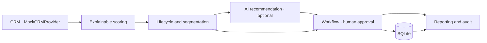

# Architecture and trust boundaries

Streamlit only calls FastAPI; it does not import database or decision logic. FastAPI owns one application service created in lifespan. Business engines are pure functions accepting a profile, rules, and an evaluation date. The repository stores Pydantic-validated contact JSON, workflow snapshots, drafts, enrollments, tasks, and audit events in SQLite. This deliberately small schema avoids an ORM while preserving atomic multi-record transitions.

SQLite `BEGIN IMMEDIATE` serializes mutation checks and writes, making concurrent simulated-send clicks idempotent. Contacts use optimistic version checks. Draft approval freezes an immutable message and its decision snapshot; contact or lifecycle/action/policy drift blocks approval and sending. Editing requires a fresh draft. Workflow ticks supersede stale unapproved drafts. A consent change causes a workflow exit. Audit entries are append-only through application code, but are not tamper-proof against database administrators.

The agent has no tool-calling capability. Its only port returns structured advice. Model output is Pydantic-validated; failures and invalid output use deterministic templates. The application owns stage, score, action, and suppression, so the LLM cannot override them. Profile fields are treated as untrusted prompt data. Message text still needs human review because schema validation does not guarantee factual or safe content.

Workflow templates are immutable, uniquely named versions. Each enrollment snapshots its template. One explicit tick executes one due step, with delays measured from completion of the previous step. Message steps block until a human-approved draft has been recorded as a simulated send. Check steps record current engagement, lifecycle, and score. A task step records qualification readiness; it does not falsely promote an unqualified MQL to SQL. A future evaluation date supports demonstrations without a background scheduler.

## Future CRM adapters

Implement `CRMProvider` for a real connector and map vendor properties to the internal domain. HubSpot lifecycle fields and Salesforce Lead/Contact/Opportunity states differ; define an explicit mapping rather than assuming identical semantics. Add OAuth secret storage, rate-limit retries with backoff, pagination, webhook signature verification, idempotency keys, incremental synchronization, per-tenant isolation, and field-level ownership/conflict handling. Route outbound communications through a separate approved outbox and retain the approval and consent checks.

No vendor SDK, real CRM connection, OAuth application, real recipient field, or delivery client is included. The current mock interface demonstrates the boundary only.
